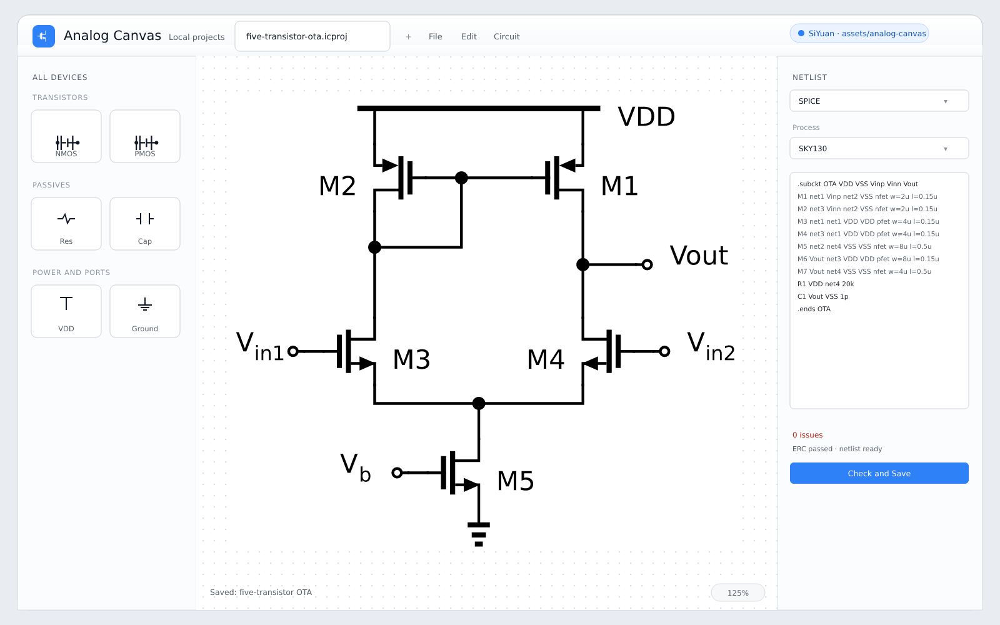

# Analog Canvas for SiYuan

[中文说明](./README_zh_CN.md)

Draw professional analog schematics inside SiYuan with the open-source
[Analog Canvas](https://github.com/cascode-ai/analog-canvas) editor. The editor
is bundled with the plugin, so it works offline and saves projects into your
SiYuan workspace — no cloud account is required.



## Features

- **Insert the finished drawing as a normal image** in the note — PNG by
  default, SVG optional. It behaves like any other SiYuan image and is part of
  the document.
- **The source stays editable**: each image is backed by an
  `assets/analog-canvas/*.icproj.json` file. Right-click the image →
  **编辑电路图** to reopen it.
- **One-click insert**: in the editor, click the floating **插入到笔记** button.
  The plugin saves the source, exports the image, and inserts it after the block
  where you typed `/ac`.
- **Full editor in a SiYuan tab** with the complete Analog Canvas toolset:
  devices, hierarchical cells, wires, labels, properties, and netlist editing.
- **Common circuit templates**: start from blank, common-source amplifier,
  current-mirror-loaded differential pair, two-stage op-amp, or five-transistor
  OTA (Sky130). Every template stays fully editable.
- **Autosave and version snapshots**: while the editor is open the project is
  saved every 15 seconds; the previous version goes to
  `assets/analog-canvas/.history` (20 kept by default). Right-click a circuit →
  **Version history** to view, restore, or branch a snapshot.
- **Close protection**: closing a dirty editor tab, pressing Ctrl/Cmd+W, or
  quitting SiYuan asks **Save and close / Close without saving / Cancel**.
- **Ctrl/Cmd+S saves directly** into `assets/analog-canvas` as
  `.icproj.json`.
- **Export SVG / PNG / SPICE / Spectre** through the editor's File menu.
  A native Save As dialog lets you choose the destination, and Settings has a
  default export folder. PNG supports 1×–6× scale (3× by default).
- **Copy to clipboard**: right-click a circuit image in a note to copy PNG or
  SVG; the editor's floating bar also has **Copy PNG / Copy SVG**.
- **Circuit management**: the picker's **⋯** menu and the circuit dock support
  open, duplicate, rename, delete and version history.
- **Online Gallery sidebar**: open the hosted Analog Canvas Gallery in a
  resizable SiYuan sidebar, sign in and browse community circuits. Copy a
  circuit from the online canvas, then click **Insert circuit** in the local
  editor to place it on the current drawing. The same entry is available from
  Settings.
- **Import projects**: bring an `.icproj.json` exported from the online editor
  into `assets/analog-canvas` from the picker or the Gallery sidebar.
- **Optional interactive preview mode**: insert a preview block instead of a
  static image (Settings → Insert as). The preview now loads the exported image
  instead of running a second renderer, so it uses much less memory.
- **Asset-based storage** so circuits and images travel with SiYuan sync,
  export and backups.

## Requirements

- SiYuan **3.1.0** or newer.
- About **8 MB** of disk space for the bundled editor (the package is about
  3 MB; PDF export and the RNL runtime are not included).
- Desktop is recommended. The preview works on mobile; the full editor also
  opens in a full-screen dialog on mobile but is heavy.

## Usage

1. Install and enable the plugin.
2. In a note, type `/ac` (or “插入电路图”), then choose a template or an
   existing project under **New**.
3. Draw the schematic in the editor tab. When done, click the floating
   **Insert into note** button (PNG by default). The plugin saves the source,
   exports the image, and inserts it after the block where `/ac` was typed.
   **Copy PNG / Copy SVG** puts the drawing on the clipboard without writing a
   file. To export a file instead, use **File → Export → Drawing as PNG/SVG**;
   the plugin opens a native Save As dialog. Settings controls the PNG scale
   (1×–6×).
4. Right-click the inserted image → **Edit circuit** to edit it again. After
   editing, click the floating **Update note image** button; both the source
   `.icproj.json` and the image in the note are updated. The image menu also
   offers **Copy PNG/SVG** and **Version history**.
   Set the default folder for the export dialog under **Settings → Default
   export folder**; leave it empty to use the last system location.
5. The picker's **⋯** menu manages circuits (open, duplicate, rename, delete,
   version history). The left circuit dock offers the same actions.
6. To borrow a circuit from the community, open **Online Gallery** from the
   top bar, the picker, the floating button in the circuit editor, or
   **Settings → Online Gallery**. It opens as a resizable sidebar. Sign in,
   open a circuit, then select all on its canvas (`Ctrl/Cmd+A`) and copy
   (`Ctrl/Cmd+C`). Switch back to the circuit editor, click **Insert circuit**
   (or press `Ctrl/Cmd+Shift+V`) and click the canvas to place the drawing.
   Only the drawing is inserted; the target project's identity is kept.
7. If copying from the embedded sidebar is not possible, use **Browser** to
   open the Gallery normally, or use **File → Export → Project File…** there
   and **Import** in the picker.

You can also open the asset picker from the top-bar button, the circuit dock,
or the command palette (`Open Analog Canvas`, `Alt+Cmd+A` on macOS). Opening an
existing project from those entry points does not insert it; use `/ac` in a
note when you want the image in the document.

The Online Gallery is a hosted service, not part of the bundled offline
editor. It needs an internet connection and a Gallery account; circuits stay
subject to their authors' terms.

## Storage and portability

```text
<workspace>/data/assets/analog-canvas/
├── five-transistor-ota-20261023123000-ab12cde.icproj.json   # source
├── five-transistor-ota-20261023123000-ab12cde.png            # inserted image
├── .history/                                                 # snapshots
│   └── five-transistor-ota-....20261024153000-ab12cde.icproj.json
└── ...
```

Because projects and images are normal SiYuan assets, they are included in
workspace export, sync and backup. The image block stores the source path in
its `custom-data-assets` attribute and the image path in
`custom-ac-image-path`.

> Do not rename or move the `.icproj.json` files outside SiYuan while notes
> reference them; use the plugin's rename action, which updates the references.

## What is bundled

- The **offline desktop composition** of Analog Canvas was built from the
  upstream repository at commit `729cfb1ed7e01f3ba5e56bd1aca41ae03731aab4`.
- The upstream source receives **small build-time patches only**: the SiYuan
  PNG scale, removal of PDF export and the RNL WebAssembly runtime, and
  disabled module preloading. All patches live in
  `scripts/build-editor.mjs`. The plugin then injects a small host shim that
  maps the editor's `/desktop/*` file bridge to the SiYuan plugin.
- Circuit templates come from the upstream example projects
  (AGPL-3.0-only).
- The editor's cloud features (account, Cloud Projects, Community Gallery,
  Agent, hosted simulation) are not bundled into the offline editor. The Online
  Gallery sidebar links to the hosted service instead; inserting its circuits
  uses the system clipboard.
- PDF export and the RNL format are not included; SVG/PNG output and
  SPICE/Spectre netlist export still work offline.
- Local user-component library is currently disabled.

## Build from source

Requirements: Node.js 24+, pnpm via Corepack, Git.

```bash
pnpm install
pnpm build          # builds the plugin and the slim editor bundle
pnpm package        # creates package.zip
pnpm make-link      # link dist/ into a SiYuan workspace (see --force)
```

`pnpm build` fetches the pinned upstream commit from GitHub (with a mirror
fallback), applies the build-time patches in `scripts/build-editor.mjs`, and
builds it. Set `AC_SKIP_EDITOR_BUILD=1` to reuse an existing `dist/editor`
while iterating on plugin code.

## Known limitations

- The bundled editor UI is English; the plugin's own dialogs are Chinese/English.
- Cloud Projects, Community Gallery, Agent, hosted simulation, the local
  user-component library, PDF export and the RNL format are not bundled. The
  Online Gallery sidebar is an optional online surface; offline SVG/PNG output,
  SPICE/Spectre netlist export and hierarchy still work.
- The Online Gallery requires account sign-in and internet access. Because it
  is a cross-origin page, circuits are transferred with the clipboard rather
  than by direct drag-and-drop; if sign-in or copy is blocked in the sidebar,
  open the Gallery in a normal browser and use the project-file import
  fallback.
- Use one circuit per editor tab. The editor can open several project tabs
  internally, but the SiYuan tab tracks the first project for its title and
  export metadata.
- After updating an image, the note may keep the old bitmap cached; reopen the
  note to be sure. The source is always up to date.
- Renaming or restoring a version is refused while the circuit is open in the
  editor; close the editor first. Renaming migrates the version snapshots and
  updates image references, but an optional interactive preview block created
  earlier must be re-inserted.
- Autosave runs every 15 seconds; closing a tab still checks for unsaved
  changes. Autosave is skipped while you are typing in a text field.
- Interactive preview mode is available in settings but the default is a static
  image.
- The native Save As dialog is desktop-only; browsers and mobile fall back to
  the browser save/download flow.
- The full editor is heavy on mobile. The image insertion and the full-screen
  mobile editor work, but desktop is recommended.

## Marketplace

The plugin is submitted to the official SiYuan community bazaar. See
[docs/marketplace.md](./docs/marketplace.md) for the release checklist and the
`plugins.txt` PR instructions.

## Changelog

See [CHANGELOG.md](./CHANGELOG.md).

## License

This plugin is licensed under **AGPL-3.0-only**, because it distributes a build
of Analog Canvas, which is also AGPL-3.0-only. The complete corresponding source
is this repository plus the pinned upstream commit listed in
[THIRD_PARTY_NOTICES.md](./THIRD_PARTY_NOTICES.md).

Copyright (C) 2026 Ray Zhang and contributors.

Analog Canvas is created by TokenZhang and the Analog Canvas contributors:
<https://github.com/cascode-ai/analog-canvas>.
